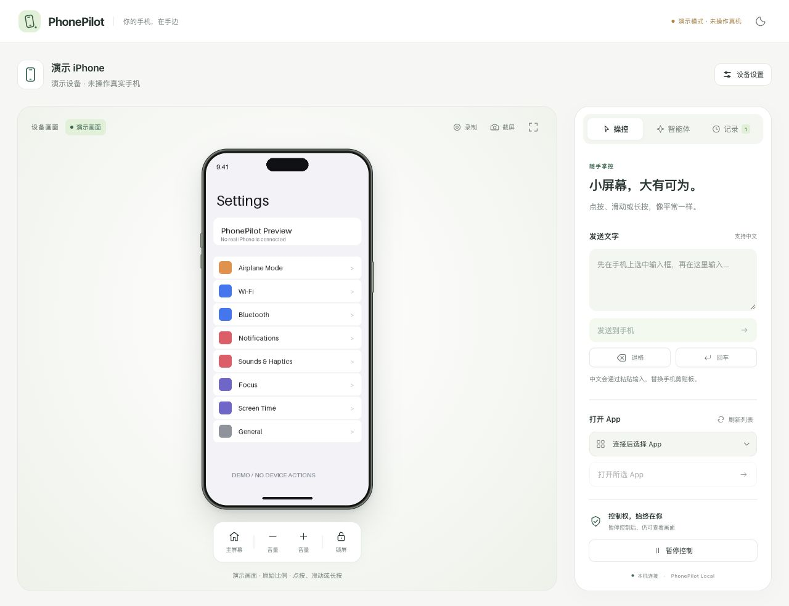

# PhonePilot Local

**让 iPhone 留在你的 AI 对话旁边。**

在 macOS 上运行的 iPhone 本地控制台：实时画面、鼠标与键盘操作，以及复用同一设备会话的 MCP 工具。项目附带可复用的智能体技能，无需 PhonePilot 账号或额外模型 API Key。

[English](README.md) · [兼容性与验证范围](docs/compatibility.md) · [架构](docs/architecture.md)



> 当前为实验版本。真机操作在一套 iPhone / iOS / Xcode 组合上验证过，其他设备组合请单独验收。上图为演示模式，不是真实手机截图。
> 建议先使用数据线：最近一次无线真机测试在控制隧道建立阶段失败，尚未通过验收。

## 可以做什么

- 查看 HEVC 实时画面；不支持时明确降级为定时截图。
- iPhone 风格机身随画面宽高比、横竖屏和侧栏大小自动适配，不在画面上重复绘制刘海或灵动岛。
- 点按、滑动、长按、输入文字、打开 App，以及主屏幕、锁屏和音量按键。
- 随时暂停与恢复控制；暂停会中止当前输入，仍可查看画面。
- 保存 PNG 截图、录制控制台画面，不包含声音。
- 通过 10 个 MCP 工具或附带的技能与兼容的 AI 应用协作。
- 支持浅色、深色外观和窄侧栏布局。

底层使用 [pymobiledevice3](https://github.com/doronz88/pymobiledevice3) 的 CoreDevice 服务，不依赖苹果的「iPhone 镜像」窗口。项目不包含 AI 模型服务，推理与额度由你使用的 AI 应用提供。

## 环境要求

- macOS、Python 3.11 或更新版本；已记录的真机验证使用 Apple 芯片 Mac。
- [uv](https://docs.astral.sh/uv/getting-started/installation/)。
- 完整 Xcode，以及与你手机 iOS 版本匹配的开发者设备支持。
- 通过 USB 连接、已解锁、已信任这台 Mac，并开启开发者模式的 iPhone。

初次信任、配对、开发者模式和设备支持准备需要手动完成。Node.js 仅用于前端开发检查，运行控制台不需要它。

## 快速开始

下载或克隆仓库，在项目目录执行：

```sh
uv sync --locked --python 3.14
uv run --locked phonepilot
```

在浏览器或 AI 应用的浏览器侧栏打开 **http://127.0.0.1:8765/**。连接并解锁手机，在「设备设置」中选择设备并点击「连接 iPhone」，等待画面更新后再操作。当前界面为简体中文。

也可以依次双击 `首次安装.command` 和 `启动 PhonePilot.command`。安装使用锁定依赖并检查所选完整 Xcode；启动器会复用已有服务、在后台启动并打开控制台，关闭启动窗口不会停止服务。首次启动不会自动连接或配对手机。

### 没有手机也可以预览

```sh
uv run --locked phonepilot --demo --port 8766 --state-dir var-demo
```

打开 **http://127.0.0.1:8766/**，连接演示设备。演示模式不会枚举或控制真实手机，界面有明显标识。请与真机服务使用不同端口及会话目录。

## 在 AI 应用中使用

### 安装技能

兼容 `~/.agents/skills` 用户技能目录的应用可执行：

```sh
python3 tools/install_skill.py
```

安装器链接到当前源码目录，不覆盖已有的其他同名技能，也不修改全局 MCP 设置。保留项目位置，移动后需要更新链接。技能发现及浏览器控制能力取决于所用应用。

示例指令：

> 用 PhonePilot 打开手机侧栏，先告诉我当前打开的是什么 App。

### 接入 MCP

启动控制台并连接手机，在「智能体 → 智能体接入设置」中复制配置，添加到 AI 应用的 MCP 设置，并按该应用要求重新加载连接。生成的配置使用你自己的项目和 Python 路径，不包含会话令牌。

提供的工具：`phone_status`、`phone_screenshot`、`phone_tap`、`phone_swipe`、`phone_long_press`、`phone_type_text`、`phone_press_key`、`phone_press_button`、`phone_list_apps`、`phone_open_app`。

工具复用控制台设备会话。基于截图的点按和滑动需要最新的 `observation_id`；编号 60 秒后失效，控制操作也会使旧编号失效。指令执行后应重新观察画面，确认实际结果。

## 隐私与边界

服务仅监听 `127.0.0.1`，检查 Host / Origin，并要求随机会话令牌。`var/` 包含本地授权文件，不应上传或分享。中文等非 ASCII 输入使用手机剪贴板粘贴，会替换当前内容，不读取旧剪贴板。

普通 API 调用不把截图、输入内容或 App 列表写入磁盘；主动下载截图、录屏则会产生文件。会话日志只记录操作类型和时间。交给 AI 的画面由你使用的 AI 应用处理，本地操控不等于本地推理。详见 [SECURITY.md](SECURITY.md)。

不支持音频、多点触控、自动解锁、自动配对或自动开启开发者模式。真机录屏、中文输入、无线、多设备和长期稳定性尚未完成验收。相机或麦克风占用、开发者服务异常可能造成中断。新屏幕形状可以自适应，不代表新机型的底层连接协议已通过验证。

## 开发与测试

```sh
uv sync --locked --extra dev --python 3.14
uv run --locked --extra dev pytest -q
npm ci
npm test
npm run format:check
uv build
uv run --locked --extra dev python tools/package_release.py --output dist/phonepilot-local-source.zip
```

Python 集成测试与前端测试均使用模拟设备，不会连接真实手机。仓库附带 macOS GitHub Actions 配置；本地通过不代表云端工作流已运行。详见 [CONTRIBUTING.md](CONTRIBUTING.md)。

## 许可与致谢

[GPL-3.0-or-later](LICENSE)。设备传输与 HID 基于固定版本的 pymobiledevice3，版本记录见 `pyproject.toml` 与 `uv.lock`。适配器使用了上游内部接口，升级前需重新验证。[THIRD_PARTY.md](THIRD_PARTY.md) 包含致谢与许可说明。本项目不隶属于 Apple 或 OpenAI。

## 连接恢复与查包裹

连接后持续验证设备可用性；断线时停止操作、清除旧截图，等待原手机返回，最多自动连接三次。暂停状态会保留，未确认的操作不会重放。超过等待范围后可在设备设置中重新连接；服务重启后需要重新选择并连接设备。实时视频异常会先显示截图并尝试恢复视频，也可点击“刷新画面”。

在当前 AI 对话中说“用 PhonePilot 查看淘宝待收货包裹”，或在智能体页复制查包裹指令。附带技能按订单和拆分包裹逐个核对实际物流节点，明确待确认项；控制台本身不包含独立任务执行模型。个人物流资料不进入项目源码或发布包。

### 数据线与无线

设备设置中可选择“数据线”或“无线”。首次无线使用：先插线、解锁并信任这台 Mac，选择该手机，明确点击“为这部手机准备无线连接”；本机会保存仅本人可读的无线配对记录。然后选择“无线”，让手机与 Mac 处于同一 Wi-Fi，刷新并连接。已有网络配对可直接被发现；普通连接和自动恢复不会创建新配对。无线模式不会暗中使用 USB，断线恢复也保持所选方式。当前无线实现已完成模拟测试；真机测试中已有配对身份校验通过，但控制隧道建立失败，尚未通过拔线后的控制验收。

自动发现不到时，可在无线入口填写手机“设置 → Wi-Fi → 当前网络详情”中的 IP。仅支持局域网 IPv4，并使用所选手机的已有配对核对身份；保存过配对不代表设备当前在线。IP 改变后需重新填写。
