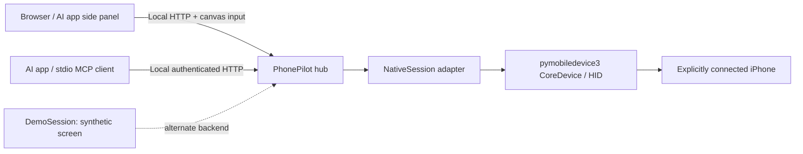

# Architecture

The hub owns one device session, serializes control actions, and handles
pause/disconnect cancellation. The console and MCP tools reuse that session rather
than opening another tunnel. The skill only starts/reuses the hub and directs a
compatible AI app to its console; it is not a separate device driver or AI service.

The browser decodes the native HEVC stream with WebCodecs when available. If the
decoder or live stream is unavailable, it explicitly falls back to screenshots.
The preview's content dimensions are fitted independently from its decorative
iPhone frame. Rounded corners are a display mask; the underlying canvas and
downloaded screenshots retain their rectangular source dimensions. Pointer
coordinates map back to normalized source coordinates.

MCP screenshots carry a bounded-lifetime observation identifier and pixel dimensions.
Pointer actions consume the identifier, preventing reuse of an obsolete observation.
A successful transport response still requires visual confirmation of the intended result.

The native adapter uses internal upstream lifecycle methods, which is why its source
revision is pinned. A future upstream update requires new compatibility testing.
Demo mode supplies synthetic PNG frames and an in-memory action recorder; it does
not call device discovery or connect to hardware.

## Connection lifecycle

After explicit connection, a read-only screenshot probe checks the session every
four seconds while no action is running. Two failed background probes, a failed
capture, or a failed control operation invalidate observations and begin bounded
recovery. The hub waits up to 60 seconds for the same trusted device to return,
then allows at most three connection attempts with backoff. A new device is never
selected automatically. Paused control stays paused and no input is replayed.
Disconnect cancels monitoring and recovery. A new connection epoch forces the
browser to discard its old picture. The browser bounds stalled video reads,
shows screenshots during up to three video retries, and exposes manual refresh.
Server restart renews browser authorization on a safe GET only; POST input is
never retried. Recovery is in memory and is not restored after a hub restart.

Installation uses the lock file and a managed Python 3.14 runtime. The read-only
doctor checks the selected full Xcode, its first-run readiness, dependencies,
discovery, trust and session separately. It does not enable Developer Mode,
accept licenses, install Xcode, or pair a device.

USB and Wi-Fi are explicit session properties. Discovery, connection and recovery use the same selection. USB restricts usbmux to USB; Wi-Fi uses an authenticated RemotePairing advertisement or a Network-only usbmux connection. The pinned userspace tunnel lifecycle is adapted in `transport.py` to choose a provider explicitly, while retaining upstream singleton ownership and teardown. No provider factory is globally monkeypatched. Only an explicit wireless-preparation action over a trusted USB connection may create a new remote pairing record, with mode 0600 before keys are written.

When multicast discovery is unavailable, a user can enter a private IPv4 address for a previously paired target. The TCP client receives the selected device’s existing lockdown record explicitly (upstream replaces its identifier with the hostname). Pair validation and the returned UDID must match before a tunnel is created. Recovery retains that address and device; it never scans unrelated addresses or creates a new pair. Offline pairing records are labelled separately from live discovery.
